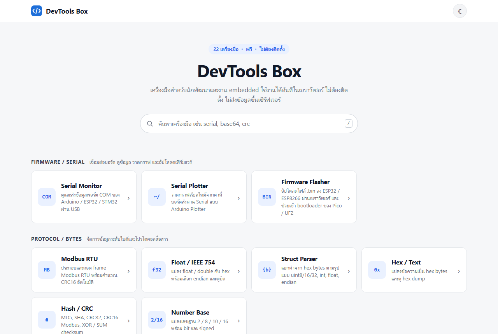
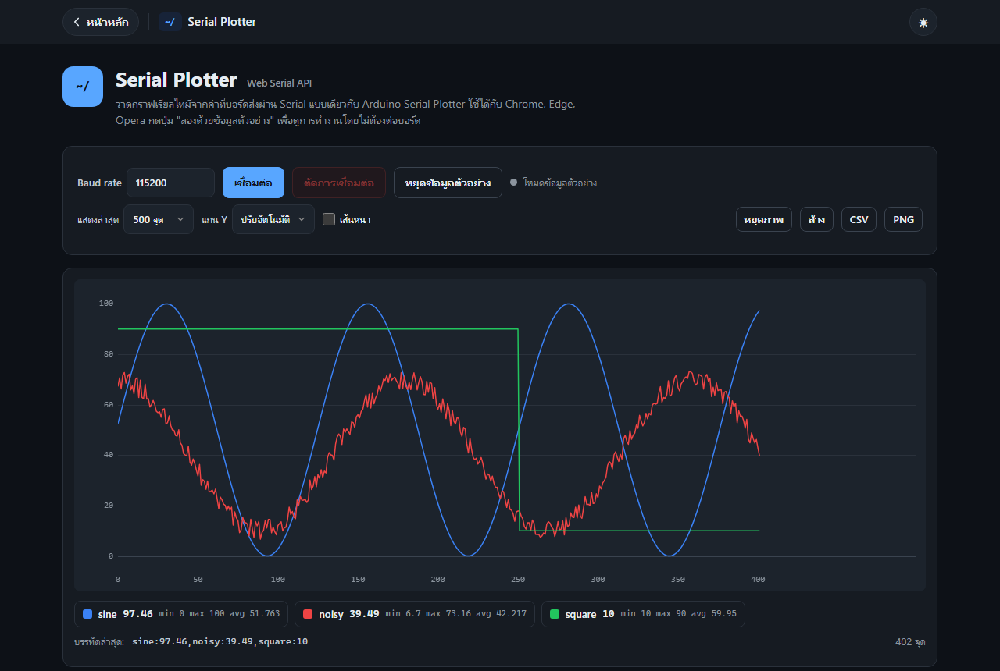
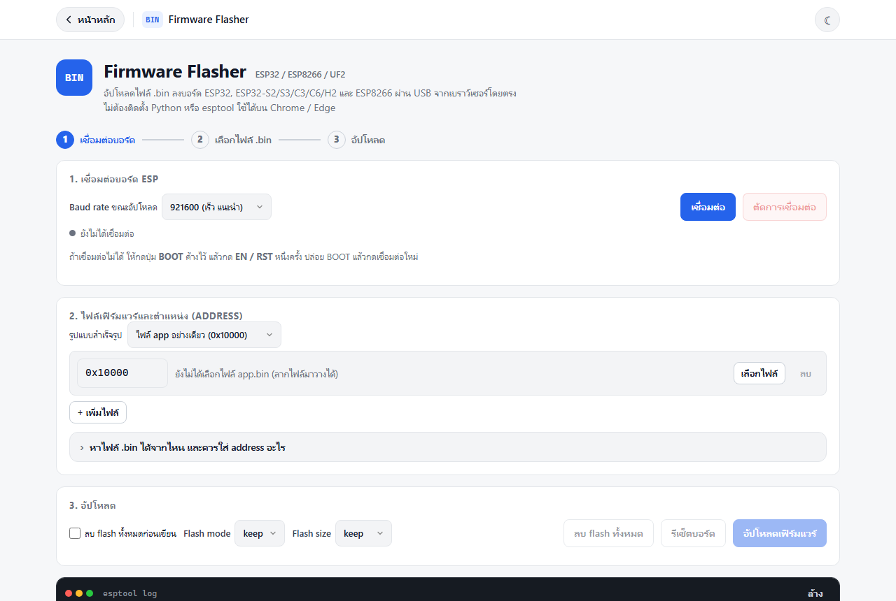
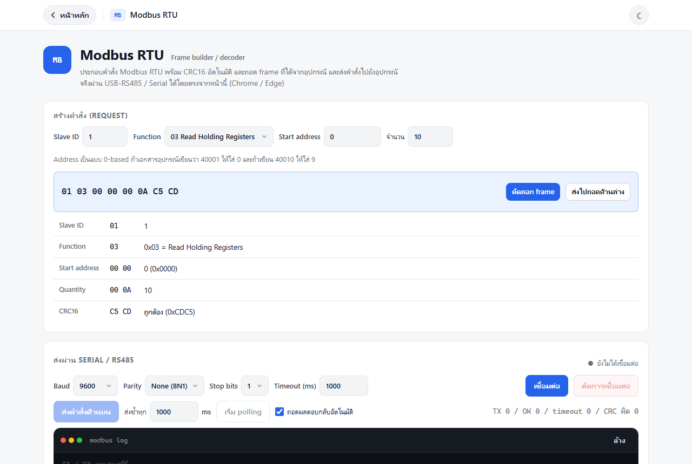
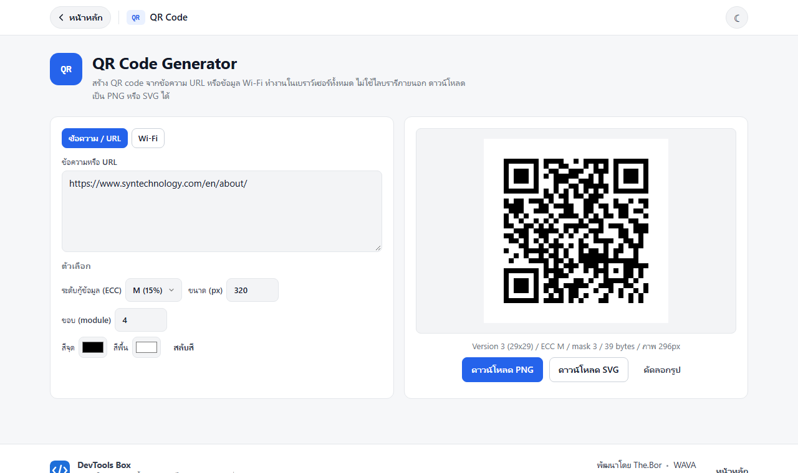
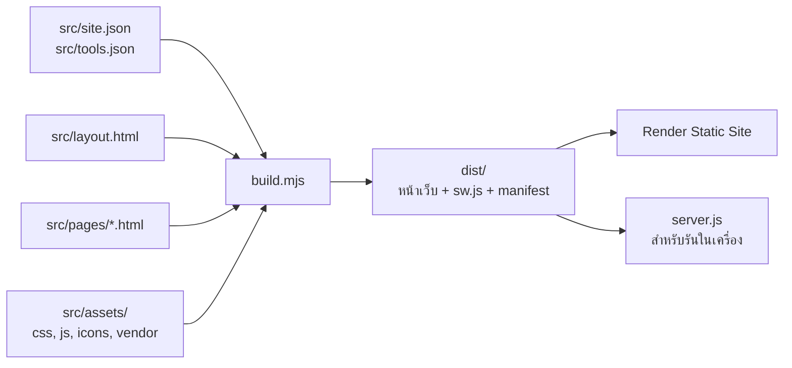

<div align="center">


# DevTools Box

**กล่องเครื่องมือสำหรับนักพัฒนาและงาน Embedded ที่ทำงานในเบราว์เซอร์ทั้งหมด**<br>
ต่อบอร์ดผ่าน USB, อัปโหลดเฟิร์มแวร์ ESP32, คุย Modbus RS485 และอีก 22 เครื่องมือ ไม่ต้องติดตั้งโปรแกรม ไม่ส่งข้อมูลขึ้นเซิร์ฟเวอร์

<!-- ใส่ลิงก์เว็บจริงจาก Render แล้วลบเครื่องหมายคอมเมนต์ออก
[](https://YOUR-SITE.onrender.com)
-->


[](https://github.com/watggwp/DevTool-Box/actions/workflows/ci.yml)


<br>

<picture>
  <source media="(prefers-color-scheme: dark)" srcset="docs/screenshots/home-dark.png">
  
</picture>

</div>

<br>

## จุดเด่น

| | |
|---|---|
| **ต่อฮาร์ดแวร์จากเบราว์เซอร์** | Serial Monitor, Serial Plotter, อัปโหลด `.bin` ลง ESP32 และส่งคำสั่ง Modbus ผ่าน USB-RS485 ได้ทันทีบน Chrome / Edge |
| **ข้อมูลไม่ออกจากเครื่อง** | ทุกเครื่องมือคำนวณในเบราว์เซอร์ ไม่มี backend ไม่มี tracking |
| **เบาทั้งสองฝั่ง** | ไม่ใช้ framework ไม่โหลดฟอนต์ภายนอก ใช้ dependency 0 ตัว และ deploy เป็น static site ที่ไม่มี server process |
| **ใช้งานออฟไลน์ได้** | เป็น PWA ติดตั้งเป็นแอปได้ เปิดได้แม้ไม่มีอินเทอร์เน็ต เหมาะกับหน้างานในโรงงาน |
| **แยกหน้าชัดเจน** | หน้าหลักแบ่งเครื่องมือตามหมวดพร้อมช่องค้นหา แต่ละเครื่องมืออยู่หน้าของตัวเอง |
| **ทดสอบอัตโนมัติ** | 26 ชุดทดสอบรันบน GitHub Actions ทุกครั้งที่ push |

## ภาพตัวอย่าง

<table>
  <tr>
    <td width="50%"><p align="center"><b>Serial Plotter</b><br>กราฟเรียลไทม์แบบ Arduino Plotter</p></td>
    <td width="50%"><p align="center"><b>Firmware Flasher</b><br>อัปโหลด .bin ลง ESP32 ใน 3 ขั้นตอน</p></td>
  </tr>
  <tr>
    <td width="50%"><p align="center"><b>Modbus RTU</b><br>ประกอบ frame, ส่งผ่าน RS485, ถอดผลตอบกลับ</p></td>
    <td width="50%"><p align="center"><b>QR Code</b><br>ข้อความ, URL และ Wi-Fi ดาวน์โหลด PNG / SVG</p></td>
  </tr>
</table>

## เครื่องมือทั้งหมด 22 รายการ

<details open>
<summary><b>Firmware / Serial</b></summary>

| เครื่องมือ | URL | ทำอะไรได้ |
|---|---|---|
| Serial Monitor | `/serial/` | ดูและส่งข้อมูลพอร์ต COM, แสดง Text / HEX, timestamp, บันทึก log, ช่วยหา driver |
| Serial Plotter | `/plotter/` | วาดกราฟสูงสุด 8 เส้น, min / max / avg, export CSV / PNG, มีโหมดตัวอย่าง |
| Firmware Flasher | `/flash/` | อัปโหลด `.bin` ลง ESP32 ทุกรุ่นและ ESP8266, ตรวจ MD5, เข้า bootloader ของบอร์ด UF2 |

</details>

<details open>
<summary><b>Protocol / Bytes</b></summary>

| เครื่องมือ | URL | ทำอะไรได้ |
|---|---|---|
| Modbus RTU | `/modbus/` | ประกอบและถอด frame, CRC16, ส่งจริงผ่าน USB-RS485 พร้อม polling |
| Float / IEEE 754 | `/float/` | float / double กับ hex, 4 รูปแบบ byte order, ดูบิต sign / exponent / mantissa |
| Struct Parser | `/struct/` | แยก packet เป็นค่า uint / int / float / string ตาม spec ที่กำหนด |
| Hex / Text | `/hex/` | แปลงข้อความกับ hex bytes และ hex dump |
| Hash / CRC | `/hash/` | MD5, SHA-1/256/384/512, CRC32, CRC16 Modbus, XOR / SUM |
| Number Base | `/base/` | ฐาน 2 / 8 / 10 / 16, 2's complement, little-endian |

</details>

<details open>
<summary><b>Electronics</b></summary>

| เครื่องมือ | URL | ทำอะไรได้ |
|---|---|---|
| Resistor / LED | `/resistor/` | แถบสีตัวต้านทาน, ค่า E12 / E24 / E96, ตัวต้านทาน LED, voltage divider |
| Board Pinout | `/pinout/` | ผังขา ESP32, ESP32-C3, ESP8266, Uno, Nano, Pico พร้อมขาที่ต้องระวัง |
| Color / RGB565 | `/color/` | HEX / RGB / HSL / RGB565 สำหรับจอ TFT พร้อมชื่อสี TFT_eSPI |

</details>

<details>
<summary><b>Encode / Decode</b></summary>

| เครื่องมือ | URL | ทำอะไรได้ |
|---|---|---|
| Base64 | `/base64/` | รองรับภาษาไทย, URL-safe และไฟล์ |
| URL Encode | `/url/` | percent-encoding และแยกส่วนประกอบ URL |
| JWT Decoder | `/jwt/` | ถอด header / payload, เวลา iat / exp |

</details>

<details>
<summary><b>Text / Data / Time</b></summary>

| เครื่องมือ | URL | ทำอะไรได้ |
|---|---|---|
| JSON | `/json/` | format, minify, validate, sort keys, escape |
| Regex Tester | `/regex/` | ไฮไลต์ผลลัพธ์, capture group, replace, กันหน้าเว็บค้าง |
| Text Diff | `/diff/` | เทียบสองข้อความแบบ side-by-side และ unified |
| Cron Expression | `/cron/` | อธิบาย cron เป็นภาษาไทย, แสดงเวลารัน 10 ครั้งถัดไป |
| Timestamp | `/time/` | Unix epoch กับวันที่ local / UTC / ISO |

</details>

<details>
<summary><b>Generators</b></summary>

| เครื่องมือ | URL | ทำอะไรได้ |
|---|---|---|
| UUID / Random | `/uuid/` | UUID v4, random bytes, password |
| QR Code | `/qr/` | ข้อความ, URL, Wi-Fi, ECC L / M / Q / H, PNG / SVG |

</details>

## เริ่มต้นใช้งาน

ต้องมี [Node.js](https://nodejs.org) 20 ขึ้นไป ไม่ต้องติดตั้ง package ใดเพิ่ม

```bash
git clone https://github.com/watggwp/DevTool-Box.git
cd DevTool-Box
npm run dev      # build แล้วเปิด http://localhost:3000
npm test         # รันชุดทดสอบทั้งหมด
```

> [!NOTE]
> Web Serial API ใช้ได้บน Chrome, Edge และ Opera เท่านั้น และต้องเปิดผ่าน HTTPS หรือ `localhost`

## Deploy บน Render

แนะนำแบบ **Static Site** เพราะไม่มี server process ส่งไฟล์ผ่าน CDN ฟรี และมี HTTPS ให้อัตโนมัติ

| ช่องตั้งค่า | ค่า |
|---|---|
| Build Command | `node build.mjs` |
| Publish Directory | `dist` |
| Root Directory | เว้นว่าง |
| Auto-Deploy | **After CI Checks Pass** |

หรือสร้างผ่าน **New > Blueprint** แล้วเลือก repo นี้ Render จะอ่าน `render.yaml` และตั้งค่า header ให้เอง

## โครงสร้างโปรเจกต์



```
src/
  site.json          ชื่อเว็บ, เครดิตใน footer, หมวดหมู่
  tools.json         รายการเครื่องมือ (1 รายการ = 1 หน้า)
  layout.html        โครงหน้าที่ใช้ร่วมกัน
  pages/             เนื้อหาของแต่ละเครื่องมือ
  assets/
    style.css        สไตล์หลัก รองรับธีมสว่าง / มืด
    css/             สไตล์เฉพาะเครื่องมือ
    js/              common.js + สคริปต์ของแต่ละเครื่องมือ
    icons/           ไอคอนแอป PWA
    vendor/          esptool-js ของ Espressif
test/                ชุดทดสอบ node:test
build.mjs            สร้างเว็บลง dist/
server.js            static server ขนาดเล็ก ใช้แค่ Node built-in
```

## เพิ่มเครื่องมือใหม่

ตัวอย่างการเพิ่มเครื่องมือ "Text Diff" ที่ `/diff/`

1. **ลงทะเบียน** ใน `src/tools.json` โดยใส่ `group` ให้ตรงกับหมวดใน `src/site.json`
   ```json
   { "slug": "diff", "group": "data", "name": "Text Diff", "ico": "+-", "desc": "เปรียบเทียบข้อความสองชุด", "keywords": "compare diff" }
   ```
2. **สร้างเนื้อหา** ที่ `src/pages/diff.html` เริ่มด้วย `<section class="tool"><h1>...</h1><p class="hint">...</p>` แล้วตามด้วย `.card`
3. **เขียน logic** ที่ `src/assets/js/diff.js` เป็น ES module และ import helper จาก `/assets/js/common.js` ได้
4. **สไตล์เฉพาะหน้า** (ถ้ามี) ที่ `src/assets/css/diff.css` ระบบจะใส่ลิงก์ให้เอง
5. รัน `npm test` หน้าใหม่ การ์ดในหน้าหลัก และ cache ออฟไลน์จะถูกสร้างให้อัตโนมัติ

## แก้เครดิตใน footer

แก้ `src/site.json` ส่วน `developer` และ `organization` ใส่ `url` ได้ถ้าต้องการให้ชื่อกดเป็นลิงก์

```json
"developer": { "name": "The.Bor", "url": "" },
"organization": { "name": "WAVA", "url": "" }
```

> [!TIP]
> บันทึกไฟล์เป็น UTF-8 เสมอ ชุดทดสอบจะแจ้งเตือนถ้าภาษาไทยถูกบันทึกผิด encoding จนเพี้ยน

## รายละเอียดทางเทคนิค

<details>
<summary><b>Firmware Flasher</b></summary>

- ใช้ [esptool-js](https://github.com/espressif/esptool-js) 0.6.1 ของ Espressif (Apache-2.0) เก็บไว้ในโปรเจกต์ และโหลดเฉพาะตอนกดเชื่อมต่อ
- รองรับ ESP32, ESP32-S2, S3, C2, C3, C5, C6, H2, P4 และ ESP8266 ตรวจ MD5 หลังเขียนทุกไฟล์
- มีรูปแบบสำเร็จรูปสำหรับไฟล์ app, merged, ชุด 4 ไฟล์ของ Arduino / PlatformIO และ ESP8266 ตั้ง address ของ bootloader ตามชิปที่ตรวจพบ
- บอร์ด UF2 เช่น Raspberry Pi Pico ใช้ปุ่ม 1200 baud touch เข้า bootloader แล้วลากไฟล์ `.uf2` ลงไดรฟ์
- ยังไม่รองรับ Arduino AVR (Uno / Nano) และ STM32

</details>

<details>
<summary><b>Modbus ผ่าน Serial / RS485</b></summary>

- ใช้ตัวแปลง USB-RS485 แบบ auto direction
- ส่งครั้งเดียวหรือ polling ตามช่วงเวลา รอคำตอบตามความยาวที่คำนวณจาก function code หรือจนเงียบเกิน 3.5 ตัวอักษร
- ตรวจ CRC, แจ้ง exception, timeout และ slave ID ที่ไม่ตรง แล้วถอดผลตอบกลับให้อัตโนมัติ

</details>

<details>
<summary><b>ใช้งานออฟไลน์ (PWA)</b></summary>

- เปิดเว็บหนึ่งครั้งขณะออนไลน์ ทุกหน้าจะถูกเก็บไว้ในเครื่อง
- `build.mjs` ตั้งชื่อ cache จาก hash ของทุกไฟล์ deploy ใหม่จึงล้าง cache เก่าเอง และผู้ใช้จะเห็นข้อความให้รีเฟรช

</details>

<details>
<summary><b>Driver ของ USB-Serial บน Windows</b></summary>

เบราว์เซอร์ตรวจสอบหรือติดตั้ง driver ให้ไม่ได้ ถ้าไม่มี driver พอร์ตจะไม่ปรากฏในหน้าต่างเลือกพอร์ต หน้า Serial Monitor จะเปิดแผงช่วยเหลือพร้อมลิงก์ดาวน์โหลดให้อัตโนมัติ

| ชิป | พบในบอร์ด | ดาวน์โหลด |
|---|---|---|
| CP210x | ESP32 DevKit, NodeMCU บางรุ่น | [Silicon Labs](https://www.silabs.com/developer-tools/usb-to-uart-bridge-vcp-drivers) |
| CH340 / CH341 | Arduino clone, NodeMCU | [WCH](https://www.wch-ic.com/downloads/CH341SER_EXE.html) |
| CH343 / CH9102 | ESP32-S3 / C3 รุ่นใหม่ | [WCH](https://www.wch-ic.com/downloads/CH343SER_EXE.html) |
| FTDI FT232 | สาย FTDI, Nano รุ่นแท้ | [FTDI](https://ftdichip.com/drivers/vcp-drivers/) |

</details>

<details>
<summary><b>ชุดทดสอบ</b></summary>

| ไฟล์ | ตรวจอะไร |
|---|---|
| `codecs.test.mjs` | Base64, hex, MD5, CRC32, CRC16 เทียบกับ `node:crypto` |
| `protocol.test.mjs` | Modbus builder / decoder / serial helper, IEEE 754, struct, plotter |
| `qr.test.mjs` | QR 40 กรณี เทียบกับ `qrcode@1.5.4` ครบ version 1 ถึง 40 และทุก mask |
| `electronics.test.mjs` | ค่าตัวต้านทาน, E-series, แถบสี |
| `text.test.mjs` | diff 300 กรณีสุ่ม, cron |
| `site.test.mjs` | ทุกหน้า ทุกลิงก์ PWA server และตรวจภาษาไทยเพี้ยน |

</details>

## เครดิต

<div align="center">

พัฒนาโดย **The.Bor** · **WAVA**

ใช้ [esptool-js](https://github.com/espressif/esptool-js) ของ Espressif Systems ภายใต้สัญญาอนุญาต Apache-2.0

</div>
